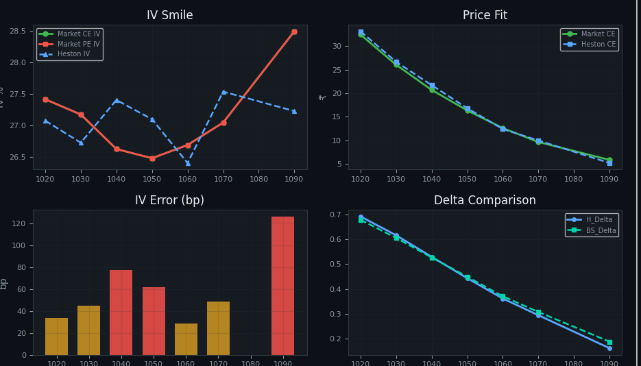
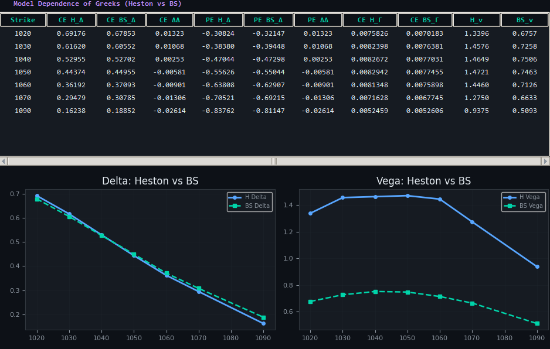
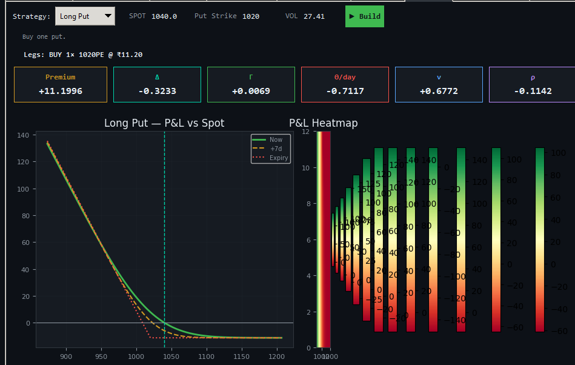
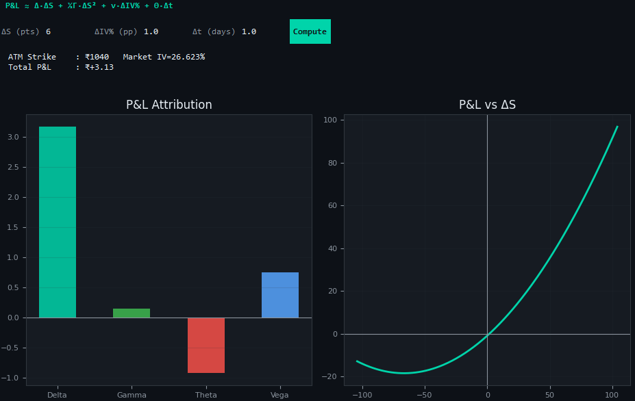

# BSM–Heston Options Research Engine

### Option pricing, stochastic volatility, Greeks and strategy analysis

A quantitative derivatives research project connecting **Black–Scholes–Merton pricing**, **Heston stochastic volatility**, **implied-volatility calibration**, **model-dependent Greeks**, **strategy construction**, and **P&L attribution** in one analytical workflow.

Developed by **Ashish Kumar A. | Helm Finserv**.

> **Education and research only.** This project is not investment advice, a recommendation to trade, or a production execution system. Model prices, sensitivities and hypothetical scenarios require independent validation.



## Project overview

The engine explores an important question in derivatives research:

**How do pricing assumptions change an option’s value, implied volatility, hedge sensitivities and strategy risk?**

The workflow starts with observed option prices and user-specified valuation inputs. It extracts implied volatility, calibrates a Heston model across strikes, compares BSM and Heston sensitivities, and evaluates the behavior of option positions under spot, volatility and time changes.

This repository presents the **core calculation logic and research results**. It contains documentation, calculation excerpts and screenshots. It does not include a runnable application or an installation procedure.

## Core capabilities

| Area | Calculation and research output |
| --- | --- |
| BSM valuation | European call/put prices with interest rates and dividend yield |
| Implied volatility | Newton–Raphson inversion with a bracketed Brent fallback |
| Heston pricing | Characteristic-function valuation using a Carr–Madan FFT grid |
| Calibration | Filtered IV targets, robust smoothing, weighted fitting and parameter regularization |
| BSM Greeks | Delta, Gamma, daily Theta, Vega, Rho, Vanna and Volga |
| Heston sensitivities | Finite differences in spot, initial variance, rate and time |
| Model comparison | Price reconciliation, IV residuals and hedge-sensitivity differences |
| Strategy analysis | Signed leg aggregation, selected stock overlays and theoretical P&L scenarios |
| P&L attribution | Local Delta–Gamma–Vega–Theta decomposition |

## Main calculation workflow

```python
# Explanatory orchestration, not an executable entry point.
# Inputs are observed prices and explicit valuation assumptions.

def main(quote_rows, valuation_inputs):
    inputs = validate_inputs(valuation_inputs)
    observations = validate_quotes(quote_rows, inputs)

    market_ivs = select_and_invert_market_iv(observations, inputs)
    parameters = calibrate_heston(market_ivs, inputs)

    results = []
    for observation, market_iv in zip(observations, market_ivs):
        bsm_risk = bsm_greeks_at_market_iv(observation, market_iv, inputs)
        heston_prices = price_under_heston(observation, parameters, inputs)
        heston_iv = invert_model_prices(heston_prices, inputs)
        heston_risk = bump_and_reprice(observation, parameters, inputs)
        comparison = compare_on_named_risk_conventions(
            bsm_risk, heston_risk, heston_iv
        )
        results.append(comparison)

    return results
```

The helper names in this overview explain the intended sequence; they are not an API exported by this repository. Input validation and common-unit comparison are explicit requirements, rather than claims that the current prototype fully implements them.

### 1. Calculate BSM prices

For spot `S`, strike `K`, time in years `T`, volatility `sigma`, risk-free rate `r`, and dividend yield `q`:

```python
d1 = (log(S / K) + (r - q + 0.5 * sigma**2) * T) / (sigma * sqrt(T))
d2 = d1 - sigma * sqrt(T)

call = S * exp(-q*T) * N(d1) - K * exp(-r*T) * N(d2)
put  = K * exp(-r*T) * N(-d2) - S * exp(-q*T) * N(-d1)
```

`N` denotes the standard normal CDF. The model provides an analytical price and a fast reference for sensitivity analysis.

### 2. Invert a price into implied volatility

Implied volatility is the `sigma` that reproduces a specified price under BSM.

```python
# Newton step: Vega here is the unscaled derivative dV/dsigma.
price_error = bs_price(S, K, T, sigma, r, q, call) - observed_price
sigma = sigma - price_error / vega_raw

# If Newton does not converge, use a bracketed root solver.
sigma = brentq(
    lambda x: bs_price(S, K, T, x, r, q, call) - observed_price,
    lower_sigma, upper_sigma
)
```

These are separate algorithmic steps, not one block that always executes both methods. Quotes outside model-consistent price bounds should be rejected before inversion.

### 3. Price under Heston stochastic volatility

Heston models variance as a mean-reverting random process:

```text
dS = (r - q) S dt + sqrt(v) S dW_S
dv = kappa (theta - v) dt + xi sqrt(v) dW_v
corr(dW_S, dW_v) = rho
```

| Parameter | Interpretation |
| --- | --- |
| `kappa` | Speed of variance mean reversion |
| `theta` | Long-run variance |
| `xi` | Volatility of variance |
| `rho` | Return–variance innovation correlation |
| `v0` | Initial variance |

The characteristic function feeds a damped Fourier inversion, producing call prices on a strike grid. Put prices follow from European put–call parity:

```python
put = call - S * exp(-q*T) + K * exp(-r*T)
```

### 4. Calibrate the model across strikes

```python
model_calls, model_puts = heston_fft(S, strikes, T, r, q, *parameters)
model_iv = model_iv_otm_from_prices(
    model_calls, model_puts, S, strikes, T, r, q
)

loss = sum(weights * (model_iv - target_iv)**2) + regularization
```

The inspected calculation uses filtered, partially smoothed IV targets and Vega-based weights. It combines seeded local optimization, differential evolution and final local refinement. Calibration is a constrained compromise across strikes, rather than a separate perfect fit at each strike.

### 5. Calculate Greeks

Analytical BSM sensitivities include:

```python
delta_call = exp(-q*T) * N(d1)
gamma = exp(-q*T) * phi(d1) / (S * sigma * sqrt(T))
vega_01 = S * exp(-q*T) * phi(d1) * sqrt(T) / 100
```

`phi` is the standard normal density. `vega_01` measures the local price change per one volatility percentage point. BSM Theta is reported per calendar day; Rho is scaled per interest-rate percentage point.

Heston sensitivities use bump-and-reprice calculations:

```python
delta = (V(S + hS) - V(S - hS)) / (2*hS)
gamma = (V(S + hS) - 2*V(S) + V(S - hS)) / hS**2
theta_day = V(T - 1/365) - V(T)
```

These are mathematical shorthand: the relevant argument is bumped while other inputs are held fixed. Numerical accuracy depends on the pricing grid, interpolation and bump sizes.

## Why market IV and Heston IV differ

| IV measure | How it is obtained |
| --- | --- |
| Raw CE IV | Invert the observed call price under BSM |
| Raw PE IV | Invert the observed put price under BSM |
| Selected market IV | Use the chosen OTM side, or average valid CE/PE IVs near ATM |
| Heston IV | Invert a Heston model price under BSM |

The prototype assigns the **same selected market IV** to both displayed CE and PE IV columns:

```python
mkt_otm_iv = iv_otm(ce_mkt, pe_mkt, S, K, T, r, q)
mkt_ce_iv = mkt_otm_iv
mkt_pe_iv = mkt_otm_iv
```

Their equality is therefore a display convention. It does not prove that independently calculated CE and PE IVs are identical.

Raw CE and PE IVs can differ when quotes are stale, asynchronous or spread-affected, or when spot, dividends, rates and expiry assumptions are inconsistent. Under European put–call parity and consistent inputs, corresponding call and put prices imply the same BSM volatility.

Heston IV differs from selected market IV because one constrained parameter vector fits an entire smile using smoothing, weighting and penalties. Numerical resolution and model limitations also contribute.

At strike **1040**, the screenshot shows approximately **26.623% market IV** and **27.400% Heston IV**: a difference of **77.7 IV basis points**. One IV basis point is 0.01 percentage point.

## Why Heston Vega and BSM Vega differ

The current comparison mixes two risk coordinates:

```python
BSM_vega_01 = dV_dsigma / 100
Heston_displayed_vega = dV_dv0 / 100
```

The first bumps **volatility**; the second bumps **initial variance**. Their difference is not a direct comparison of the same volatility shock.

For a local initial-volatility comparison, apply the chain rule:

```python
sigma0 = sqrt(v0)
Heston_sigma0_vega_01 = 2 * sigma0 * Heston_displayed_vega
```

With displayed `v0 = 0.05787`, the conversion factor is about `0.4811`. At strike 1040, a displayed Heston value of `1.4649` becomes approximately `0.7048` per initial-volatility point, compared with BSM Vega near `0.7506` at model-implied IV. This is an illustrative calculation using rounded screenshot values.

Even after conversion, the sensitivities need not agree: Heston initial volatility mean-reverts, while a BSM volatility bump changes the constant volatility assumption over the entire remaining life. A market-IV surface bump followed by recalibration is a different risk measure again.



## Why BSM and Heston prices can match while Greeks differ

The workflow inverts a Heston price to a BSM implied volatility and then reprices with BSM. Price agreement follows from that inversion.

The models can still respond differently to spot or variance changes. Matching a price at one input point does not force its derivatives to match. The **BS Greeks** tab uses selected market IV; the **Greeks Compare** tab uses BSM sensitivities at Heston-implied IV.

## Strategy construction and portfolio risk

The strategy layer combines signed option quantities and, for selected structures, a stock position:

```python
portfolio_delta = sum(leg.qty * leg.delta for leg in legs) + stock_qty
portfolio_gamma = sum(leg.qty * leg.gamma for leg in legs)
portfolio_vega  = sum(leg.qty * leg.vega for leg in legs)

pnl = sum(
    leg.qty * (scenario_value(leg) - leg.entry_value)
    for leg in legs
) + stock_qty * (scenario_spot - entry_spot)
```

Scenario values are BSM theoretical values in the inspected strategy implementation. Entries are model prices at a user-specified volatility, not executable prices. The current prototype does not automatically optimize strategies using Heston signals.



The menu contains **31 labels**, of which **15 have explicit option-leg mappings** in the inspected version. The other **16 fall back to a long straddle**. The full catalogue distinguishes intended constructions from existing code behavior:

**[View every strategy, its intended use and implementation status](docs/STRATEGIES.md).**

## P&L attribution

```python
delta_pnl = delta * spot_change
gamma_pnl = 0.5 * gamma * spot_change**2
vega_pnl = vega_01 * iv_change_percentage_points
theta_pnl = theta_day * elapsed_days

total = delta_pnl + gamma_pnl + vega_pnl + theta_pnl
```

The displayed 1040-call example uses a +6 spot move, +1 IV percentage point and one elapsed day. Rounded inputs give approximately:

| Component | Contribution per underlying unit |
| --- | ---: |
| Delta | +3.1634 |
| Gamma | +0.1427 |
| Theta | −0.9263 |
| Vega | +0.7505 |
| **Total** | **+3.1303** |

This is a local Taylor approximation, not realized P&L. Large changes require full repricing and residual analysis.



## Analytical views

| View | Main purpose |
| --- | --- |
| Market Chain | Observed CE/PE prices, selected IV and intrinsic value |
| 4-Step Workflow | Heston price → internal risk → implied IV → BSM comparison |
| BS Greeks | Analytical sensitivities at selected market IV |
| Heston Greeks | Finite-difference sensitivities under frozen parameters |
| Greeks Compare | Differences between model-dependent hedge estimates |
| IV & Fit | Smile shape, price fit, IV errors and Delta comparison |
| Strategy | Leg construction, aggregated risk and scenario P&L |
| P&L Attribution | Delta/Gamma/Vega/Theta explanation of a local move |
| Calib Log | Parameter, optimization and fit diagnostics |

## Research findings and current limitations

- Price agreement does not imply hedge agreement.
- The displayed CE and PE IVs share one selected IV; independent CE/PE inversion must be retained separately to study parity discrepancies.
- Initial-variance sensitivity must be converted or relabeled before comparison with volatility Vega.
- A selected **Bear Call Spread** currently builds a long straddle. The screenshot exposes that mismatch; it is not an example of a correct bear call spread.
- Some iron-condor labels reverse common long/short naming. Actual signed legs determine the exposure.
- Repeated strategy builds accumulate colorbars and crowd the heatmap.
- The attribution spot-shock curve omits the Vega shock used in the bar-chart total.
- Exact expiry handling, contract sizing, costs, margin and settlement need further work.
- FFT resolution, interpolation and bump-size convergence need independent verification.

See **[calculation conventions and validation priorities](docs/METHODOLOGY.md)** for details.

## What this project achieves

The project connects option valuation, implied volatility, stochastic-variance calibration, model-sensitive hedging and multi-leg risk analysis. It makes the assumptions behind a derivative price visible and demonstrates how those assumptions flow into strategy scenarios and P&L explanations.

The result is an educational research prototype and a framework for further validation. It does not establish a profitable trading edge or production readiness.

## Repository contents

- `README.md`: project overview and main calculation logic.
- `docs/METHODOLOGY.md`: numerical conventions and validation priorities.
- `docs/STRATEGIES.md`: all 31 menu labels, intended uses and code status.
- `screenshots/`: ten analytical screenshots, cropped for presentation.

No market dataset is bundled. Screenshots are historical project observations; figures from different screenshots should not be treated as one synchronized valuation snapshot.

## References

- Heston, S. L. (1993), [A Closed-Form Solution for Options with Stochastic Volatility](https://doi.org/10.1093/rfs/6.2.327).
- Carr, P. and Madan, D. B. (1999), [Option Valuation Using the Fast Fourier Transform](https://wwwf.imperial.ac.uk/~ajacquie/IC_Num_Methods/IC_Num_Methods_Docs/Literature/CarrMadan.pdf).
- Options Industry Council, [Options strategy reference](https://www.optionseducation.org/strategies/all-strategies-en).

## Disclaimer

**For educational and research purposes only.** Nothing in this repository is personalized financial, investment, tax or legal advice, or a recommendation to buy, sell or hold any security or derivative. Options can involve substantial losses, including unlimited losses for uncovered calls. Model assumptions, stale observations, calibration error and software defects can materially affect results. Hypothetical calculations do not guarantee future performance. Independent validation is required before practical use.
