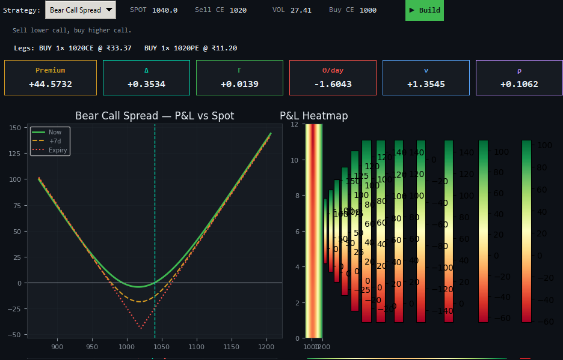

# Strategy catalogue

The inspected version advertises 31 strategy labels. Fifteen have explicit option-leg mappings, including three structures with additional stock overlays. Sixteen reach a default long straddle instead.

**Mapped does not mean validated or execution-ready.** Descriptions below explain the intended payoff and educational use. They do not recommend a trade.

For butterflies and condors, strikes must be correctly ordered; equal wing widths apply to standard symmetric examples. All legs share expiry except a calendar.

| Menu label | Intended or mapped construction | How and when to use | Current code status |
| --- | --- | --- | --- |
| Long Call | Buy one call. | Bullish move with loss limited to premium. | Mapped |
| Short Call | Sell one call. | Neutral-to-bearish premium view, with potentially unlimited upside loss. | Mapped |
| Long Put | Buy one put. | Bearish exposure or a downside hedge, at the premium cost. | Mapped |
| Short Put | Sell one put. | Neutral-to-bullish premium view, accepting substantial downside exposure. | Mapped |
| Long Straddle | Buy call and put at the same strike and expiry. | A sufficiently large move in either direction. | Mapped |
| Short Straddle | Sell call and put at the same strike and expiry. | A narrow-range or falling-IV view, with severe tail risk. | Mapped |
| Long Strangle | Buy a lower-strike put and higher-strike call. | A large move beyond more distant break-evens. | Mapped |
| Short Strangle | Sell a lower-strike put and higher-strike call. | A broader range-bound view, with large tail exposure. | Mapped |
| Long Butterfly CE | Buy lower call, sell two middle calls, buy upper call. | An expiry near the middle strike with defined wings. | Mapped |
| Short Butterfly CE | Sell lower call, buy two middle calls, sell upper call. | An expiry away from the middle strike. | Mapped |
| Long Butterfly PE | Buy lower put, sell two middle puts, buy upper put. | An expiry near the middle strike through equal-width put wings. | Fallback |
| Short Butterfly PE | Sell lower put, buy two middle puts, sell upper put. | An expiry move away from the middle. | Fallback |
| Long Iron Condor | Code: buy outer put/call and sell inner put/call. | Range-bound credit-condor exposure with bounded wings; naming is reversed from common convention. | Mapped* |
| Short Iron Condor | Code: sell outer put/call and buy inner put/call. | Debit reverse-condor exposure for a move outside the inner range; naming is reversed from common convention. | Mapped* |
| Long Iron Butterfly | Buy middle straddle and sell outer strangle. | Intended debit reverse-iron-butterfly exposure for a move away from the middle. | Fallback |
| Short Iron Butterfly | Sell middle straddle and buy outer strangle. | Intended credit exposure for a narrow range with protected wings. | Fallback |
| Bull Call Spread | Buy lower call and sell higher call. | Moderate bullish exposure with capped gain and defined cost. | Fallback |
| Bear Call Spread | Sell lower call and buy higher call. | Neutral-to-bearish credit exposure with defined wing risk. | Fallback |
| Bull Put Spread | Buy lower put and sell higher put. | Neutral-to-bullish credit exposure with a protective lower wing. | Fallback |
| Bear Put Spread | Buy higher put and sell lower put. | Moderate bearish exposure at reduced premium and capped gain. | Fallback |
| Bull Risk Reversal | Sell lower put and buy higher call. | Bullish exposure partly financed by substantial short-put downside. | Fallback |
| Bear Risk Reversal | Buy lower put and sell higher call. | Bearish exposure partly financed by unlimited short-call upside risk. | Fallback |
| Long Call Ratio 1x2 | Intended: sell one lower call and buy two higher calls. | Call backspread for a sufficiently large upside move, with an intermediate loss zone. | Fallback |
| Short Call Ratio 1x2 | Intended: buy one lower call and sell two higher calls. | Limited upside move, accepting uncovered extra-call tail risk. | Fallback |
| Long Put Ratio 1x2 | Intended: sell one higher put and buy two lower puts. | Put backspread for a sufficiently large decline, with an intermediate loss zone. | Fallback |
| Short Put Ratio 1x2 | Intended: buy one higher put and sell two lower puts. | Modest decline or stable prices, accepting large additional downside risk. | Fallback |
| Covered Call | Long stock and short call. | Mildly bullish income view when stock downside and capped upside are acceptable. | Mapped |
| Protective Put | Long stock and long put. | An expiry downside floor while retaining stock upside, for a premium. | Mapped |
| Cash-Secured Put | Short put with exercise cash reserved. | Potential stock acquisition at a chosen strike with assignment funding available. | Fallback |
| Collar | Long stock, long lower put and short higher call. | Bound stock expiry outcomes while accepting an upside cap. | Mapped |
| Calendar Spread | Buy longer expiry and sell shorter expiry at the same strike. | Near-term strike-centered view and term-structure exposure, requiring per-leg maturities. | Fallback |

## Known mismatch shown in the screenshots

The selected label says Bear Call Spread, but the displayed position buys a call and put at strike 1020. Its V-shaped expiry behavior follows a long straddle. The intended bear call spread must instead sell a lower call and buy a higher call.

## Naming and implementation notes

- **Mapped***: the source’s iron-condor long/short labels reverse common convention. Follow the signed legs and credit/debit exposure.
- **Fallback**: the current default is a long call plus long put at the first strike; it does not implement the named strategy.
- Ratio names vary. The explicit constructions in this table define the intended meaning; the source has no corresponding ratio branch.
- A cash-secured put requires a cash/collateral representation, not just an option leg.
- A calendar requires two actual maturities and expiry-aware scenario logic.
- The strategy layer uses BSM theoretical pricing. It is not an automatic Heston strategy optimizer.
